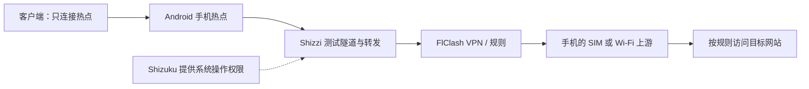

# Android Software Router — 安卓免刷机软路由

用原厂 Android 手机搭建轻量软路由：**其他手机、平板或电脑只连接它的热点，就能按手机上的 FlClash 规则访问网络，无需在客户端安装代理应用或填写代理地址。**

方案由 **Shizuku + Shizzi + FlClash** 组成，不需要解锁引导加载程序、Root 或刷机。面向符合版本、权限和网络能力要求的 Android 设备；**OPPO A97 是已经完成实测的案例，不是方案的机型限制。**

本仓库提供工具与配置说明、首次配置、日常启动、恢复与验证流程，以及可复用的 skill。仓库原名 `oppo-a97-vpn-hotspot`，skill 原名 `android-shizuku-hotspot`；现统一使用 Android Software Router 命名。

[下载 skill 压缩包](downloads/android-software-router.zip?raw=true) · [查看 skill](skills/android-software-router/SKILL.md) · [验证流程与结果](docs/validation.md) · [排障与经验](docs/troubleshooting.md)

## 1. 最终目的与软路由定位

手机作为下游设备的网络网关，由 Android 完成热点地址分配、转发与 NAT，由 Shizzi 建立共享流量进入 VPN 的路径，再由 FlClash 按规则处理流量。因此，**本项目可以称为轻量安卓软路由，重点用途是 VPN 透明共享热点与 Wi-Fi 中继**。刷机不是承担软件路由功能的前提。[Android 官方网络共享说明](https://source.android.com/docs/core/ota/modular-system/tethering) · [Shizzi 工作机制](https://github.com/carlelieser/shizzi)

它不承诺完整 OpenWrt 的全部管理能力；这里的“透明”是指客户端无需设置代理，不表示所有协议和异常状态都已经通过防泄漏验证。



Shizuku 提供所需权限，Shizzi 建立热点到 VPN 的共享路径，FlClash 运行使用者自己的代理配置。**仅在手机上开启 VPN，不能证明热点流量也经过 VPN。**本案例使用规则模式，国内站点按规则直连可以是预期行为，不要求所有请求都显示国外出口。

### 已验证案例

2026-10-10 至 2026-10-11，在 OPPO A97 5G（PFTM10 / OP526D，原厂 ColorOS 14 / Android 14，arm64）完成了以下验证。更详细的版本、观察过程和证据来源见 [实测记录](skills/android-software-router/references/a97-verified-case.md)。

| 场景 | A97 案例结果 |
| --- | --- |
| 使用手机自己的 SIM 流量分享热点 | 客户端可新开 Google 搜索、播放 YouTube 新视频，代理请求出口符合预期 |
| 连接上游 Wi-Fi 后分享热点 | 关闭手机移动数据后仍正常，确认实际为 Wi-Fi 中继 |
| USB 启动后拔掉数据线、手机熄屏约 5 分钟 | 用户报告仍可联网，出口仍为预期地区 |
| 本机无线调试启动 Shizuku 后断开辅助 Wi-Fi | 用户报告 Shizuku 继续可用，热点客户端仍能访问外网 |
| 停止 FlClash VPN | 当次测试约 10 秒内观察到热点自动关闭；不是瞬时、绝对防泄漏证明 |

**尚未证明：**只有 SIM 的冷启动全自动恢复、长期待机、完整 DNS / IPv6 / UDP 泄漏表现，以及其他机型的实际稳定性。

## 2. 兼容条件与工具

### 设备条件

- 本教程固定版本组合以 **Android 13+、arm64** 为部署基线，不按品牌筛选。Android 版本和 CPU 架构符合要求，仍需继续做兼容性与下游测试。
- Shizzi 的 **Test network API**、**Prefer test networks** 两项检测应通过；厂商对 ADB / Shizuku 权限的限制需要按实际系统处理。
- SIM 分享需要可用的移动数据。Wi-Fi 中继还需要手机、系统与当前频段支持 **同时连接 Wi-Fi 和开启热点**；不能仅凭 Android 版本判断。
- 无线启动 Shizuku 时，准备一个可信 Wi-Fi，或另一部手机临时提供的热点。此辅助网络用于启动；启动后的独立运行情况需要实测。
- 准备独立测试设备，用来验收真正的热点下游效果。
- Windows 电脑与 USB 数据线仅作为后备启动工具；日常无线启动不必连接电脑。

本教程固定的是已经成功使用的版本。上游新版本可能扩展或改变兼容范围；使用其他版本时，请对照其发布说明和设备检测，不能把本仓库的成功记录直接当作新组合的验收结果。

### 应用与职责

| 工具 | 已验证版本 | 用途 / 官方下载 |
| --- | --- | --- |
| Shizuku | `13.6.0.r1086.2650830c` | 提供免 Root 系统操作权限；[发布页](https://github.com/RikkaApps/Shizuku/releases/tag/v13.6.0) |
| Shizzi | `0.4.0-rc.3` | 将热点流量经手机 VPN 共享；[发布页](https://github.com/carlelieser/shizzi/releases/tag/v0.4.0-rc.3) |
| FlClash | `0.8.99`，arm64 | 运行使用者自己的代理配置；[发布页](https://github.com/chen08209/FlClash/releases/tag/v0.8.99) |
| Android SDK Platform-Tools | 可选 | Windows USB 后备启动时提供 ADB；[Google 官方下载](https://developer.android.com/tools/releases/platform-tools) |

Shizzi 这一基线版本仍为 RC。本仓库不镜像 APK，也不提供订阅；使用者自行在 FlClash 导入可用配置。案例安装包的公开 SHA-256 记录见 [安装包核验](skills/android-software-router/references/a97-verified-case.md#基线安装包核验记录)。

## 3. 首次配置：优先在手机上完成

### 第一步：准备权限与后台设置

1. 安装三个应用并开启开发者选项；具体入口随厂商而异，可参考 [Shizuku 官方指南](https://shizuku.rikka.app/zh-hans/guide/setup/)。
2. 保持 **开发者选项、USB 调试**开启。“USB 调试开启”不等于需要一直插线。
3. 允许 Shizuku、Shizzi、FlClash 所需的通知与后台运行；遇到省电限制时，按系统提供的选项允许相应应用运行。本案例对 Shizzi 和 FlClash 取消了电池优化限制。
4. 若 Shizuku 提示权限受限，按厂商说明排查。**ColorOS 案例：**A97 的“禁止权限监控”需要开启，才能取消限制；这不是所有 Android 都具有或必须更改的开关。其他系统按实际文案和官方指南处理。
5. 若发生 Shizuku 随机停止，可参考官方指南将默认 USB 配置设为“不用于数据传输 / 仅充电”。A97 案例在切换此设置时曾停止服务，重启 Shizuku 后恢复；修改后应检查服务状态。

### 第二步：无线配对并启动 Shizuku

首次配对通常只需做一次；后续重新启动服务，不等于每次重新输入配对码。

1. 让这台 Android 手机连接可信 Wi-Fi，也可以连接另一部手机的热点。
2. 打开 Shizuku，选择 **“通过无线调试启动 → 配对”**。
3. 按提示进入系统 **“无线调试”** 并开启。系统询问网络授权时允许该可信网络；需要后续复用时勾选“始终允许此网络”。
4. 点 **“使用配对码配对设备”**，在 Shizuku 通知中输入显示的六位码。
5. 返回 Shizuku 点 **“启动”**，确认服务运行且没有权限受限提示。

保存过 Wi-Fi 密码，不等于已信任该网络用于无线调试；电脑曾获 USB 调试授权，也不等于 Shizuku 自身已完成无线配对。[官方无线启动说明](https://shizuku.rikka.app/zh-hans/guide/setup/)

**A97 已验证：无线启动成功后可断开辅助 Wi-Fi，Shizuku 仍运行，代理热点可继续使用。**首次换到另一台手机时，按 [无线启动验收](docs/validation.md#6-免电脑无线启动再断开辅助-wi-fi) 复测。保留开发者选项与 USB 调试，无需保持数据线连接。

### 第三步：配置 FlClash 与 Shizzi

1. 在 FlClash 自行导入配置，选择可用节点，启动 VPN，并允许 Android 的 VPN 连接请求。
2. 确认手机自己能够发起目标请求。保留需要的分流规则；成功案例使用规则模式。
3. 检查分应用设置是否覆盖实际转发进程。ADB 模式下，Shizuku 启动的转发进程使用 **shell UID 2000**；不能只把 Shizzi 普通应用加入 VPN 白名单，就认定共享流量已被覆盖。
4. 在 Shizzi 授予 Shizuku 使用权限，确认两项兼容性检测均支持。
5. 将 **Shizzi 内的 VPN 选项设为 Always**。这是应用内部设置，与 Android 系统的“始终开启 VPN”不同。
6. 在 Shizzi 点 **Start**，检查 `Connected`、`VPN CONNECTED`、`TUNNEL ACTIVE`。
7. 让独立测试设备连接这台手机的热点，完成下一节验收。热点名称和密码可使用自己的原设置。

本次成功路径没有永久关闭共享硬件卸载，没有修改 iptables，也不需要客户端手动代理。

## 4. 日常使用与恢复顺序

**Shizuku 正常运行 → FlClash VPN 已连接 → Shizzi Start。**

- **SIM 分享：**完成无线启动后断开辅助 Wi-Fi，开启手机移动数据，再依次恢复 VPN 与 Shizzi 共享。
- **Wi-Fi 中继：**让手机连接上游 Wi-Fi，再启动 VPN 与 Shizzi。首次测试关闭手机移动数据，排除 SIM 回退；若系统无法同时保持 Wi-Fi 和热点，当前组合不能按此方式中继。
- **正常停止：**先 Shizzi Stop，再停止 FlClash。
- **手机重启或 Shizuku 已停止：**临时连接可信 Wi-Fi，重新启动 Shizuku，再恢复 VPN 与共享。Shizuku 已运行时，不必每次开热点都重新激活。
- **VPN 意外停止、热点关闭：**先恢复 FlClash，再从 Shizzi 点 Start。

**不要直接重开系统“个人热点”来恢复代理共享。**案例中，VPN 停止后 Shizzi 自动关闭了热点；随后人工重开系统热点，客户端走了普通直连。若已经这样操作，按 [恢复步骤](docs/troubleshooting.md) 结束旧会话，再从 Shizzi 启动共享。

## 5. 怎样验证真的成功

在独立测试手机、平板或电脑上：

1. 关闭客户端自己的移动数据、其他联网路径和 VPN，Wi-Fi 代理保持“无”，只连接软路由手机的热点。
2. 新开一个 Google 搜索，再实际播放一段新的 YouTube 视频，避免把缓存当成联网成功。
3. 在浏览器地址栏打开 [Cloudflare trace](https://www.cloudflare.com/cdn-cgi/trace)。这是纯文字页面，找到 `ip=` 和 `loc=` 两行。
4. 按 FlClash 当前规则选择明确经过代理的请求，比较当次预期出口；不要把历史 IP 或固定国家当作永远不变的标准。
5. 分别在 **手机仅 SIM 上游**、**手机仅 Wi-Fi 上游** 下重复测试，记录本机是否通过。

[完整验证流程](docs/validation.md) 还包含无线启动后断 Wi-Fi、VPN 中断、拔线熄屏测试，并区分工具观察、用户报告与待验证项目。

手机上的 VPN 图标、Shizuku“正在运行”和 Shizzi“Connected”都是中间状态，不能单独替代下游验证。

## 6. 有用的经验与现有边界

- **不需要为了这个目标先刷机。**原厂系统上的组合已实现基本功能；能否解锁、Root 属于另外的问题。
- **区分启动条件与运行条件。**官方无线启动流程需要辅助 Wi-Fi；启动后是否可脱离它，应在实际设备上验证，A97 已通过。
- **厂商设置放在对应机型中理解。**例如 ColorOS 的“禁止权限监控”要开启，不能机械套用到其他系统。
- **恢复时保持入口正确。**从 Shizzi 重建共享，单独打开系统热点可能建立普通直连。
- **以真实客户端的新请求验收。**关闭客户端其他路径，分别验证 SIM 和 Wi-Fi 上游。
- **已实现轻量软路由，不等于已完成无人值守验证。**五分钟熄屏成功不能推导整夜稳定；无线启动后断 Wi-Fi 成功不能推导仅 SIM 冷启动自举。

以下能力仍需专项验证：

| 项目 | 当前边界 |
| --- | --- |
| 仅 SIM、无辅助 Wi-Fi 的冷启动自动恢复 | 本案未实现，不应承诺 |
| 重启后全部应用自动恢复 | 未验证。Shizuku 13.6 在 Android 13+ 可信 WLAN 上有条件的自启能力，不等于整套共享自动恢复；[发行说明](https://github.com/RikkaApps/Shizuku/releases/tag/v13.6.0) |
| DNS、IPv6、UDP/QUIC 与故障瞬间防泄漏 | 未完成独立验证；YouTube 能播放不能单独证明 UDP 可用 |
| 长期运行与深度休眠 | 当前只有约五分钟熄屏记录 |
| 其他机型、系统更新与不同频段 | 需要重新检查兼容性、共享路径和下游结果 |

## 7. 使用随附的 skill

skill 是给 Codex 等支持技能目录的工具使用的经验流程包，**不是 Android APK**。不使用 Codex，也可以按本文手动配置。

- [skill 源码目录](skills/android-software-router/)
- [完整压缩包](downloads/android-software-router.zip?raw=true)
- [SHA-256 校验文件](downloads/android-software-router.zip.sha256.txt)

在 Codex 中可输入：

```text
用 $skill-installer 安装 https://github.com/tukitohosi/Android-software-router/tree/main/skills/android-software-router
```

也可将完整 `android-software-router` 文件夹放入当前环境识别的技能目录。当前官方文档的用户级目录为 `~/.agents/skills/`；本案例桌面环境也已识别 `~/.codex/skills/`。以实际环境为准，不要只复制单个 `SKILL.md`。从旧名称升级时，先保留必要备份，再替换旧目录，避免两个版本同时被加载。未显示时重启 Codex。[官方技能安装说明](https://learn.chatgpt.com/docs/build-skills)

安装后示例：

```text
用 $android-software-router 帮我配置或恢复安卓手机的代理热点，先检查型号、系统、兼容性和当前状态。
```

skill 包含主流程、配置与恢复参考、A97 实测案例，以及 Windows USB 后备脚本。仅安装 skill 不会自动修改手机。

### Windows USB 后备工具

脚本位于 [skills/android-software-router/scripts/](skills/android-software-router/scripts/)。将两个文件保持在同一目录，可双击 `Start-Android-Shizuku.cmd`。默认 ADB 位置为 `%LOCALAPPDATA%\Android\Sdk\platform-tools\adb.exe`；未安装时先下载官方 Platform-Tools。

PowerShell 示例，在脚本所在目录执行：

```powershell
# 只检查目标设备及前置条件，不启动手机上的服务
.\Start-Android-Shizuku.ps1 -CheckOnly

# ADB 不在默认目录时，指定自己的安装路径
.\Start-Android-Shizuku.ps1 -AdbPath 'C:\Android\platform-tools\adb.exe' -CheckOnly

# 连接多台设备时，明确选择目标；替换示例占位符
.\Start-Android-Shizuku.ps1 -Serial 'YOUR_DEVICE_SERIAL' -CheckOnly

# 检查通过后，去掉 -CheckOnly 才会尝试启动 Shizuku
.\Start-Android-Shizuku.ps1 -Serial 'YOUR_DEVICE_SERIAL'
```

脚本不按 OPPO 型号筛选，检查当前目标和 Shizuku 安装信息；它不能替代 Shizzi 的兼容性检测。正式执行只负责启动 Shizuku，仍需在手机上启动 FlClash 和 Shizzi，并完成下游验证。新安装布局或未验证架构需要另行核实，不应把脚本检测通过当作整套方案的跨机型认证。已经正常运行时无需反复执行。

## 8. 文件结构与来源

```text
README.md                         兼容 Android 的完整教程
docs/validation.md                通用验收步骤与 A97 案例结果
docs/troubleshooting.md           故障恢复、经验与厂商差异
skills/android-software-router/  可复用 skill 与 USB 后备工具
downloads/                       对应 skill ZIP 与校验文件
```

本仓库整理者：[tukitohosi](https://github.com/tukitohosi)。教程由实际设备操作、用户独立客户端验证和官方资料核查整理，使用 Codex 协助编写；不是 Android、OPPO、Shizuku、Shizzi 或 FlClash 的官方项目。方案面向兼容 Android，已完成的实体设备验收范围以案例记录为准。

第三方应用及源码遵循各自仓库许可证。本仓库发布经验、流程和后备工具，不重新分发第三方 APK、订阅、凭据或个人设备原始日志。

主要资料：

- [Android 网络共享模块](https://source.android.com/docs/core/ota/modular-system/tethering)
- [Shizuku 官方指南](https://shizuku.rikka.app/zh-hans/guide/setup/)
- [Shizzi 项目](https://github.com/carlelieser/shizzi)
- [FlClash 项目](https://github.com/chen08209/FlClash)
- [Shizuku 13.6 无线启动实现](https://github.com/RikkaApps/Shizuku/blob/v13.6.0/manager/src/main/java/moe/shizuku/manager/home/AdbDialogFragment.kt)
- [Shizuku 13.6 开机启动实现](https://github.com/RikkaApps/Shizuku/blob/v13.6.0/manager/src/main/java/moe/shizuku/manager/receiver/BootCompleteReceiver.kt)
