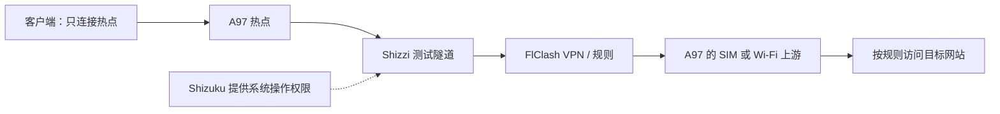

# OPPO A97 免 Root 代理热点实测

用原厂 Android 手机实现一个可随身携带的代理 Wi-Fi：**其他手机、平板或电脑只连接热点，就能按手机上的 FlClash 规则访问网络，不需要在客户端安装代理应用或填写代理地址。**

本案例使用 **OPPO A97 5G + Shizuku + Shizzi + FlClash**，没有解锁、Root 或刷机。实测时间为 **2026-10-10 至 2026-10-11**。仓库包含完整操作教程、排障经验、验证方法，以及可交给 Codex 复用的 skill。

**已经实现：SIM 代理热点、Wi-Fi 中继、USB 拔线后短时熄屏使用，以及本机无线启动 Shizuku 后断开辅助 Wi-Fi 继续分享代理网络。**

**尚未证明：只有 SIM 的冷启动全自动恢复、长期待机、完整 DNS / IPv6 / UDP 泄漏表现。**这些边界不影响本次基本使用目标已达成，但不能将本案推广成所有 OPPO 手机通用的无人值守软路由方案。

[下载 skill 压缩包](downloads/android-shizuku-hotspot.zip?raw=true) · [查看 skill](skills/android-shizuku-hotspot/SKILL.md) · [验证流程与结果](docs/validation.md) · [排障与经验](docs/troubleshooting.md)

## 1. 最终效果与工作方式

| 使用场景 | 本次结果 |
| --- | --- |
| A97 使用自己的 SIM 流量，其他设备连接它的热点 | 客户端可新开 Google 搜索、播放 YouTube 新视频，出口与预期代理节点一致 |
| A97 连接现场 Wi-Fi，再供其他设备连接热点 | 关闭 A97 移动数据后仍正常，确认实际为 Wi-Fi 中继 |
| USB 启动后拔掉数据线、手机熄屏约 5 分钟 | 用户报告仍可联网，出口仍为预期地区 |
| 无线调试启动 Shizuku 后关闭 A97 Wi-Fi | 用户明确报告 Shizuku 继续可用，热点客户端仍能访问外网 |
| 停止 FlClash VPN | 此次测试在约 10 秒内观察到热点自动关闭；不是瞬时、绝对防泄漏的证明 |

代理流量的概念路径：



Shizuku 负责提供所需权限，Shizzi 建立热点到 VPN 的共享路径，FlClash 提供用户自己的代理配置。**仅在手机上开启 VPN，不能直接证明热点流量也经过 VPN。**

FlClash 本案使用规则模式；国内站点按规则直连可以是预期行为，不要求所有请求都显示国外出口。

## 2. 准备哪些工具

### 手机与测试条件

- 一台兼容手机。本案例为 **OPPO A97 5G，型号 PFTM10 / OP526D，ColorOS 14 / Android 14**，构建 `PFTM10_14.0.0.3000(CN01)`，arm64。
- 自己已有且可用的代理配置或订阅，由使用者在 FlClash 内导入。
- 一个供无线启动使用的 Wi-Fi，或另一部手机临时开启的热点。
- 一台独立测试设备，用来检验真正的热点下游效果。
- Windows 电脑和 USB 数据线仅作为应急后备；日常无线启动不必连接电脑。

### 应用与职责

以下是**本次成功组合**，不是对最新版的声明。下载时使用对应项目的官方发布页。

| 工具 | 本次版本 | 用途 / 官方下载 |
| --- | --- | --- |
| Shizuku | `13.6.0.r1086.2650830c` | 提供免 Root 系统操作权限；[发布页](https://github.com/RikkaApps/Shizuku/releases/tag/v13.6.0) |
| Shizzi | `0.4.0-rc.3` | 共享手机 VPN 给热点；[发布页](https://github.com/carlelieser/shizzi/releases/tag/v0.4.0-rc.3) |
| FlClash | `0.8.99`，arm64 | 运行使用者的代理配置；[发布页](https://github.com/chen08209/FlClash/releases/tag/v0.8.99) |
| Android SDK Platform-Tools | 可选 | Windows USB 后备启动时提供 ADB；[Google 官方下载](https://developer.android.com/tools/releases/platform-tools) |

Shizzi 此版本仍标为 RC。其他机型不能只凭同属 OPPO A 系列就判断兼容：本方案以 Android 13+ 为基线，还需在 Shizzi 中确认 **Test network API**、**Prefer test networks** 均支持。

本仓库不镜像 APK，不提供订阅。原安装包的公开 SHA-256 和核验方式见 [案例记录](skills/android-shizuku-hotspot/references/a97-verified-case.md#基线安装包核验记录)。

## 3. 首次配置

### 第一步：准备系统设置

1. 安装上述三个应用。开启手机开发者选项，在设置中搜索“开发者选项”可帮助定位；如尚未启用，可按 [Shizuku 官方指南](https://shizuku.rikka.app/zh-hans/guide/setup/) 操作。
2. 保持 **开发者选项、USB 调试**开启。这里的“USB 调试开启”不要求一直插线。
3. 本机 ColorOS 开关叫 **“禁止权限监控”**，将它**开启**后，Shizuku 的 ADB 权限受限提示才消失。官方指南中的“关闭权限监控”是同一个含义，要按实际文案判断方向。
4. 默认 USB 配置设为 **“不用于数据传输 / 仅充电”**。切换该模式后检查 Shizuku 是否还在运行；本案切换期间服务曾停止，重新启动后恢复。
5. 允许相关组件后台运行。给 Shizzi 所需的通知、后台运行权限；本案 Shizzi 和 FlClash 已设为忽略电池优化。

### 第二步：在 A97 自己完成无线配对

这一步用于摆脱电脑。首次配对通常只做一次；以后重新启动服务不等于重新输入配对码。

1. A97 连接一个 Wi-Fi，也可以临时连接另一部手机的热点。
2. 打开 Shizuku，选择 **“通过无线调试启动 → 配对”**。
3. 按提示进入系统 **“无线调试”** 并开启。系统询问是否允许此网络调试时，选择 **“始终允许此网络”**。
4. 点 **“使用配对码配对设备”**，从 Shizuku 通知输入显示的六位配对码。
5. 返回 Shizuku 点 **“启动”**，确认服务运行、没有权限受限提示。

保存过 Wi-Fi 密码，不等于已信任该网络用于无线调试；电脑曾获 USB 调试授权，也不等于 Shizuku 自身完成了无线配对。操作来源：[官方无线启动说明](https://shizuku.rikka.app/zh-hans/guide/setup/)。

**本机已实测：无线启动成功后，可以断开辅助 Wi-Fi，Shizuku 仍正常运行。**保留 USB 调试开关，无需保留数据线。另一台设备或更新后的固件应单独验证这一点。

### 第三步：配置 FlClash 与 Shizzi

1. 在 FlClash 自行导入已有配置，选择可用节点，启动 VPN，并允许 Android 的 VPN 连接请求。
2. 确认 FlClash 真实处于连接状态。保留需要的分流规则；本案是规则模式。
3. 检查分应用设置是否排除了共享流量。本案转发相关进程使用 **shell UID 2000**，VPN 覆盖了主用户 UID 范围；不能只把 Shizzi 普通应用加入白名单就认定完整覆盖。
4. 在 Shizzi 授予 Shizuku 使用权限，检查两个兼容性项目均支持。
5. 将 **Shizzi 内的 VPN 选项设为 Always**。这不是 Android 系统设置中的“始终开启 VPN”。
6. 在 Shizzi 点 **Start**，查看 `Connected`、`VPN CONNECTED`、`TUNNEL ACTIVE`。
7. 让测试设备连接 A97 热点，按下文验证。热点名称和密码可继续使用自己的原设置。

本案没有通过永久关闭共享硬件卸载、修改 iptables 或修改客户端代理来实现功能。

## 4. 日常使用：记住一个顺序

**Shizuku 正常运行 → FlClash VPN 已连接 → Shizzi Start。**

- **用 SIM 分享**：无线启动完成后关闭 A97 的 Wi-Fi，打开自己的移动数据，再按顺序开启 VPN 和 Shizzi 共享。
- **做 Wi-Fi 中继**：A97 连接上游 Wi-Fi，再按顺序开启 VPN 和 Shizzi；首次验证时关闭 A97 移动数据，排除流量回退。
- **正常停止**：先 Shizzi Stop，再停止 FlClash。
- **手机重启或 Shizuku 已停止**：临时连接 Wi-Fi，重新启动 Shizuku，再恢复 VPN 和共享。已经运行时不必每次开热点都重新激活。
- **VPN 意外停止、热点关闭**：先恢复 FlClash，再在 Shizzi 点 Start。

**不要直接重开系统“个人热点”来恢复代理共享。**本次测试中，VPN 停止后 Shizzi 自动关闭了热点；随后人工重开系统热点，客户端就走了普通直连。若已经这样操作，参考 [恢复步骤](docs/troubleshooting.md) 清理旧会话后从 Shizzi 重新启动。

## 5. 怎样验证真的成功

在独立测试手机或平板上：

1. 关闭它自己的移动数据和 VPN，Wi-Fi 代理保持“无”，只连接 A97 热点。
2. 新开一个 Google 搜索，再实际播放一段新的 YouTube 视频。
3. 在浏览器地址栏输入 [Cloudflare trace](https://www.cloudflare.com/cdn-cgi/trace)。它是纯文字页面，找到 `ip=` 和 `loc=` 两行。
4. 比较当前预期代理节点的出口；不要以历史 IP 或固定国家作为永远不变的标准。
5. 分别在 **A97 仅 SIM**、**A97 仅 Wi-Fi 上游** 下重复，以区分两个使用场景。

完整验证表、无线启动断 Wi-Fi 的验证、VPN 停止测试、短时熄屏测试，以及每项证据来自工具还是用户，见 [验证流程与结果](docs/validation.md)。

手机上的 VPN 图标、Shizuku 的“正在运行”、Shizzi 的“Connected”都只是中间状态，不能单独作为客户端成功的证据。

## 6. 本次最有用的经验

1. **最终不需要刷机。**最初考虑 Root 和自动恢复，但具体 A97 固件没有经验证的解锁、备份与救砖条件。改走免 Root 路线后，基本目标已实现。
2. **启动依赖与运行依赖要分开。**官方无线启动时需要辅助 Wi-Fi；本机启动成功后已经验证能离开它继续用 SIM。
3. **读实际开关文案。**“禁止权限监控”要开启，不要看到官方写“关闭权限监控”就机械地把所有类似开关关闭。
4. **不要绕过共享组件。**系统热点能联网不代表它通过 Shizzi 和 FlClash；一次人工误操作足以使出口改变。
5. **从真正的客户端验收。**关闭客户端自身流量和 VPN，再发起新请求，能排除常见假阳性。
6. **保留证据边界。**五分钟熄屏成功不等于全天运行；无线启动成功也不等于仅 SIM 冷启动自动恢复。

更多故障现象、原因与处理方式见 [排障与经验](docs/troubleshooting.md)。

## 7. 哪些事情还没有解决

- **户外只有 SIM、手机重启后无人干预恢复整套代理热点**：本案没有实现。无线启动后断 Wi-Fi 成功，不代表可以从关机状态完全脱离辅助网络启动。
- **开机自动启动**：Shizuku 13.6 官方支持 Android 13+ 在可信 WLAN 上有条件地尝试自启，但本案例没有验收其开机成功率，更没有证明 FlClash、Shizzi 会一起自动恢复。[发行说明](https://github.com/RikkaApps/Shizuku/releases/tag/v13.6.0)
- **所有协议与异常状态的防泄漏**：未完成独立 DNS、IPv6、UDP/QUIC 和逐包断 VPN 验证。
- **长时稳定与其他机型**：未做长时待机、深度休眠或跨机型认证。Shizzi 基线版本仍是 RC。

## 8. 使用随附的 skill

这个 skill 是给 Codex 等支持技能目录的工具使用的经验与流程包，**不是 Android APK**。不使用 Codex 也可以直接按本文手动完成配置。

- [skill 源码目录](skills/android-shizuku-hotspot/)
- [原始压缩包](downloads/android-shizuku-hotspot.zip?raw=true)
- [SHA-256 校验文件](downloads/android-shizuku-hotspot.zip.sha256.txt)

在 Codex 中可使用内置安装器，输入：

```text
用 $skill-installer 安装 https://github.com/tukitohosi/oppo-a97-vpn-hotspot/tree/main/skills/android-shizuku-hotspot
```

也可解压完整 `android-shizuku-hotspot` 文件夹，放入当前环境识别的技能目录。当前官方文档的用户级目录为 `~/.agents/skills/`；本案例桌面环境也已识别 `~/.codex/skills/`。以实际环境为准，不要只复制单个 `SKILL.md` 或同时安装多份同名 skill。未显示时重启 Codex。[官方技能安装说明](https://learn.chatgpt.com/docs/build-skills)

安装后示例：

```text
用 $android-shizuku-hotspot 帮我恢复 A97 的代理热点，先确认当前状态。
```

skill 包含主流程、两份参考资料和两个 Windows USB 后备脚本。它不会仅因被安装就自动修改手机。

### USB 后备工具

脚本位于 [skills/android-shizuku-hotspot/scripts/](skills/android-shizuku-hotspot/scripts/)。两个文件保持在同一目录，双击 `Start-OPPO-PlanA.cmd`。默认 ADB 位置为 `%LOCALAPPDATA%\Android\Sdk\platform-tools\adb.exe`；使用前先安装官方 Platform-Tools，路径不同时需调整脚本中的路径。

该工具仅匹配一台已授权的 **PFTM10 / arm64**，动态查找 Shizuku 安装位置。PowerShell 参数 `-CheckOnly` 只做前置检查。正式执行只启动 Shizuku，随后仍需在手机上启动 FlClash 和 Shizzi；不要在已经正常运行时无故重新执行。新版本安装布局不同可能不适用。

## 9. 文件结构与来源

```text
README.md                         面向使用者的完整教程
docs/validation.md                验证流程、结果与证据边界
docs/troubleshooting.md           故障恢复与经验
skills/android-shizuku-hotspot/   可复用 skill 和 USB 后备工具
downloads/                       同一份 skill ZIP 与校验文件
```

本仓库整理者：[tukitohosi](https://github.com/tukitohosi)。教程由实际设备操作、用户独立客户端验证和官方资料核查整理，使用 Codex 协助编写；不是 OPPO、Shizuku、Shizzi 或 FlClash 的官方项目。

第三方应用及其源码遵循各自仓库的许可证。本仓库只发布经验、流程和本次编写的后备工具，不重新分发第三方 APK、订阅、凭据或个人设备原始日志。公开内容的适用范围以本次设备与实测记录为准。

主要资料：

- [Shizuku 官方指南](https://shizuku.rikka.app/zh-hans/guide/setup/)
- [Shizzi 项目](https://github.com/carlelieser/shizzi)
- [FlClash 项目](https://github.com/chen08209/FlClash)
- [Shizuku 13.6 无线启动实现](https://github.com/RikkaApps/Shizuku/blob/v13.6.0/manager/src/main/java/moe/shizuku/manager/home/AdbDialogFragment.kt)
- [Shizuku 13.6 开机启动实现](https://github.com/RikkaApps/Shizuku/blob/v13.6.0/manager/src/main/java/moe/shizuku/manager/receiver/BootCompleteReceiver.kt)
